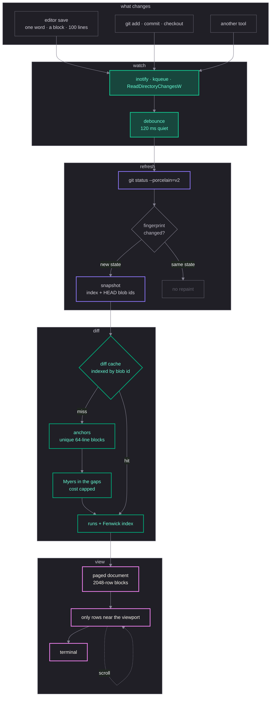

<div align="left">
  

  <p style="margin: 0;">
    <strong>A live diff viewer for working trees bigger than your screen.</strong>
    It refreshes in about a tenth of a second while you edit, pages diffs with
    millions of rows instead of choking on them, stages, commits and pushes
    without leaving the pane, and ships as one 11 MB binary with no libgit2
    inside. If the tree is clean, a small twig grows where the diff would be.
  </p>
</div>

It drives `git` for repository state and diffs with its own engine, so ignore
rules, rename detection and index races behave like the `git` you already use.

## Why it's fast

|                          | twig                                            | the usual viewer                  |
| ------------------------ | ----------------------------------------------- | --------------------------------- |
| a save                   | ~150 ms, watched, no repaint if nothing changed | manual refresh, or a full re-read |
| a 100000 line file added | 4.7 ms, 14 allocations                          | seconds, hundreds of thousands    |
| a 5000 line rewrite      | 12.6 ms, 3.0 ms paged                           | quadratic on adversarial edits    |
| idle                     | 0% CPU                                          | a timer that keeps re-reading     |

The engine anchors on unique blocks first and only runs Myers inside the gaps,
under a cost cap, so a rewrite that would pin a core for a minute is a few
milliseconds. Nothing is kept per row: a diff is a list of runs with a prefix
index, and a document only materialises the rows near the viewport.

## Install

```sh
go install samouly.fun/twig@latest
```

Or build it yourself, with [Task] or plain Go:

```sh
task                 # trimmed release build, version stamped from git
go build -trimpath -ldflags "-s -w" -o twig .
```

## Usage

```sh
twig              # unstaged changes
twig --staged     # staged changes
twig HEAD~2       # what a commit changed
twig main..HEAD   # what a range changed
twig log          # browse commits, open any of them
```

## Keys

`H` and `L` bring a sidebar in; the diff gets the whole window otherwise.
Search and the list filters run as you type, and `esc` clears either.

| Key                                  | Action                                          |
| ------------------------------------ | ----------------------------------------------- |
| `enter`                              | open diff / jump to file / expand a tree folder |
| `esc`                                | back to the sidebar                             |
| `tab` / `shift+tab`                  | next / previous pane                            |
| `j` / `k`, `d` / `ctrl+u`, `f` / `b` | scroll the diff                                 |
| `h` / `l`, `←` / `→`                 | horizontal scroll (when wrap is off)            |
| `[` / `]`                            | previous / next hunk                            |
| `J` / `K`                            | next / previous file                            |
| `g` / `G`                            | top / bottom                                    |
| `t`                                  | tree / flat listing                             |
| `a`                                  | all changes in one scroll                       |
| `H` / `L`                            | left / right sidebar                            |
| `/`                                  | filter files, or search the diff                |
| `n` / `N`                            | next / previous match                           |
| `s` / `u`                            | stage / unstage                                 |
| `C` / `P`                            | commit / push                                   |
| `y` / `Y`                            | copy the patch / the hunk                       |
| `v` / `w`                            | split view / soft wrap                          |
| `Z` / `c`                            | ignore whitespace / cycle context               |
| `r` / `?` / `q`                      | refresh / help / quit                           |

## Config

`twig.json` from `$XDG_CONFIG_HOME/twig` or `~/.config/twig`; `--config` points
it elsewhere. Every key is optional.

```json
{
  "context": 3,
  "ignore-whitespace": false,
  "wrap": false,
  "line-numbers": true,
  "watch": true,
  "watch-debounce": 120,
  "sidebar-width": 32,
  "show-left-sidebar": false,
  "show-right-sidebar": false,
  "smooth-scroll": true,
  "log-limit": 200,
  "split-view": false
}
```

`watch` is the live view: a debounced change becomes one status run, and a
refresh that finds nothing new does not touch the screen. `watch-debounce` is
the quiet period in milliseconds, 120 by default. `show-left-sidebar` and
`show-right-sidebar` decide what the window opens with, and `H` / `L` write the
choice back. Events come from inotify, kqueue or `ReadDirectoryChangesW`, so a
save lands in about a tenth of a second; when they cannot carry the view the
footer says `polling` and a two second pass takes over.

## How it works



**One status run.** `git status --porcelain=v2` carries the index and HEAD blob
ids, so diffs are keyed by content ids: switching files is a lookup, and an
unchanged refresh costs no repaint. Caches are bounded by bytes, because an
entry-count bound lets a handful of huge files hold hundreds of megabytes.

**Anchors before Myers.** Identical 64-line blocks that occur once on each side
are matched, the gaps between them are diffed with the linear-space
[Myers algorithm][Myers] under a cost cap scaled like git's [xdiff], and only
regions small enough to be exact get an exact script. What remains after a
two-second budget is reported as a wholesale replacement, which is always a
valid script. The anchoring is [Bentley–McIlroy]'s, the same idea git credits as
patience and histogram matching; bounding the work is what [difftastic] and
[diff-match-patch] do in their own ways.

**Ids, runs, documents.** Lines are interned behind a 64-bit [`maphash`]
fingerprint and checked against the line they came from, so a collision probes
instead of equating two different lines. A paged diff is a list of runs
(`Equal`, `Delete`, `Insert`, `Replace`) with their source ranges and a
[Fenwick] prefix index, so a file added whole is two runs however long it is,
and a row needs no stored counter. The all-changes view streams blocks, indexes
them the same way, and builds only the rows near the viewport; searching a paged
file scans the two sources and maps a byte offset back to its line.

**Git does git.** Status, rename detection, ignore rules and the racy index are
delegated to the `git` binary through porcelain. A blobless partial clone still
works: `git cat-file` fetches on demand, and an object that is genuinely gone
degrades to one band saying so instead of failing the view.

**A commit is a list first.** Selecting one reads changed paths, which is tree
data and no content. Small commits are diffed whole; a large one becomes a
streaming document where each file is generated as it scrolls into view, with
counts filling in as they arrive.

**The window comes first.** Opening a repository can take seconds, so the branch
label, the status and the log all load as commands: the window is on screen and
fills in, and a slow commit load never takes the pane away from the file you are
reading.

## Testing

The engine is checked three ways: invariants over a corpus of ~1000 generated
pairs (spans on rune boundaries, pairing a partial bijection, order-preserving,
symmetric under swap), golden files that pin the exact row and span layout, and
an oracle that builds files with known edits so a missed or cross-pair is a
counted error. `go test ./internal/diff -update` regenerates the goldens.

## Benchmarks

One laptop, 12-core i7-9850H, Go 1.27.3, medians of three runs; treat the spread
as ~20% and compare runs rather than the table.

| Benchmark             | Time    | Allocations |
| --------------------- | ------- | ----------- |
| 5000 lines, 400 edits | 12.6 ms | 19 698      |
| the same, paged       | 3.04 ms | 56          |
| 100000 line addition  | 4.68 ms | 14          |
| 20000 row repaint     | 1.52 ms | 1 230       |
| one scroll step       | 0.36 ms | 278         |

A 100000 line addition retains 3.09 MB for 2.69 MB of source, and paging costs
a quarter of materialising the same rows, which is why the viewer pages above
4096 rows.

## Development

```sh
task test   # go test -race
task lint   # gofmt, staticcheck, golangci-lint
task run    # go run .
```

CI runs gofumpt, vet on every release platform, the test suite with the race
detector, a release build under a 12 MB size guard, and a goreleaser snapshot so
a broken release config fails on a branch instead of during a tag. A `v*` tag
publishes the cross-compiled binaries, checksums and packages.

## Acknowledgments

Standing on the shoulders of [Charm] — [Bubble Tea v2], [Bubbles v2], [Lip Gloss
v2], [ultraviolet], [harmonica], [fang] and [tone] — and [Task] for the build.

## License

Apache License, Version 2.0. See [LICENSE](LICENSE).

[Bubble Tea v2]: https://github.com/charmbracelet/bubbletea
[Bubbles v2]: https://github.com/charmbracelet/bubbles
[Lip Gloss v2]: https://github.com/charmbracelet/lipgloss
[ultraviolet]: https://github.com/charmbracelet/ultraviolet
[harmonica]: https://github.com/charmbracelet/harmonica
[fang]: https://github.com/charmbracelet/fang
[tone]: https://github.com/charmbracelet/tone
[Charm]: https://charm.sh
[Task]: https://taskfile.dev
[Myers]: http://www.xmailserver.org/diff2.pdf
[Bentley–McIlroy]: https://dl.acm.org/doi/10.1145/359460.359467
[xdiff]: https://github.com/git/git/tree/master/xdiff
[difftastic]: https://github.com/Wilfred/difftastic
[diff-match-patch]: https://github.com/google/diff-match-patch/wiki/API
[Fenwick]: https://en.wikipedia.org/wiki/Fenwick_tree
[maphash]: https://pkg.go.dev/hash/maphash
